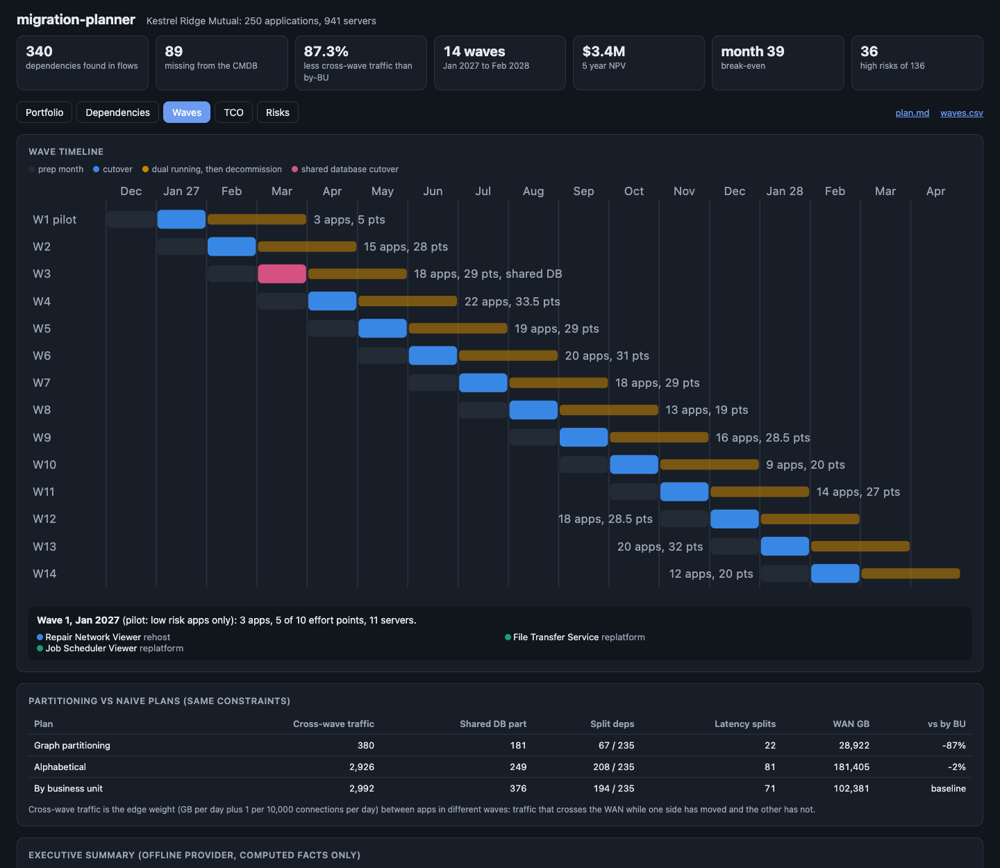
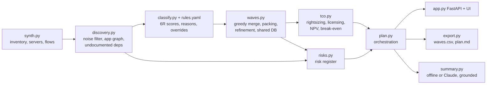
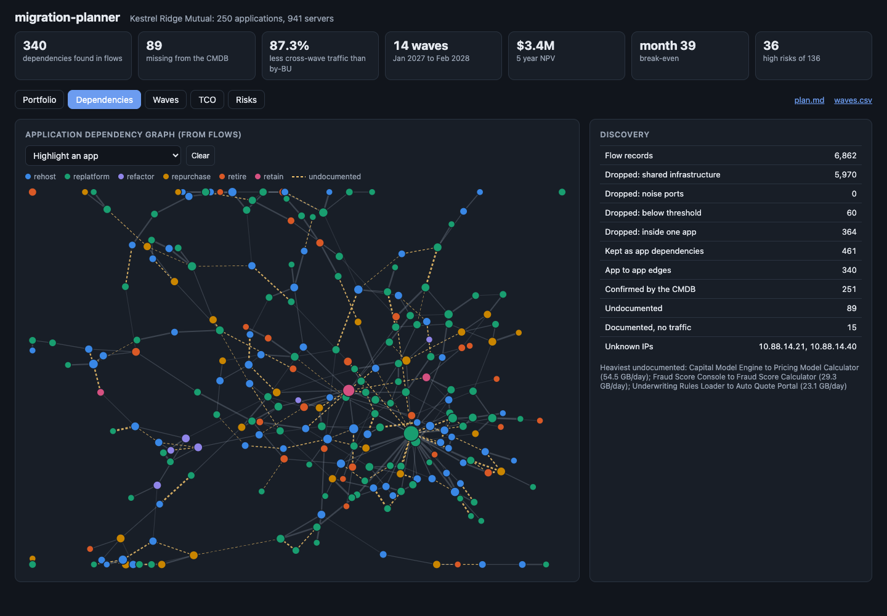

# migration-planner

A planning tool for a data center exit. It takes a messy application inventory and two weeks of network flows and produces a sequenced, costed, risk-assessed migration plan: dependencies discovered from traffic, a 6R decision with reasons for every app, monthly waves that keep chatty systems together, a five year TCO with NPV and break-even, and a generated risk register. It runs on a laptop against a seeded synthetic estate for Kestrel Ridge Mutual, a made-up regional insurer with 250 applications, 941 servers, and 6,862 flow records.



## Wave plan comparison

All three planners get the same 217 movable apps and the same hard constraints (wave capacity, team capacity and availability, change freezes, a low risk pilot wave, mission critical apps not before wave 4). The metric is cross-wave dependency traffic: the weight of every dependency whose two ends move in different waves, which is the traffic that crosses the WAN while one side is in the cloud and the other is not.

| Plan | Cross-wave traffic (weight/day) | Of which shared DB | Split dependencies | Latency sensitive splits | WAN GB during migration | vs by business unit |
|---|---|---|---|---|---|---|
| Graph partitioning (greedy merge + refinement) | 380 | 181 | 67 of 235 | 22 | 28,922 | -87% |
| Alphabetical | 2,926 | 248 | 208 of 235 | 81 | 181,404 | -2% |
| By business unit | 2,992 | 376 | 194 of 235 | 71 | 102,381 | baseline |

Edge weight is GB per day plus 1 per 10,000 connections per day, so a chatty link counts even when it moves few bytes. WAN GB multiplies each split dependency's daily volume by the months between its two waves. Grouping by business unit sounds sensible and barely beats alphabetical order: most business units are bigger than one wave, so their systems still get cut apart by name order, and 1 in 6 dependencies crosses business units anyway. CI runs the full plan on every push, posts this table to the job summary, and fails if partitioning does not beat both naive plans.

Other results on the sample estate:

| | |
|---|---|
| Dependencies found in flows | 340 (89 missing from the CMDB, 15 documented ones with no traffic) |
| Flow records dropped as noise | 6,401 of 6,862 (monitoring, backup, directory, patching, scanner, tier to tier) |
| Discovery vs generator ground truth | precision 1.00, recall 1.00 |
| 6R mix | 109 replatform, 75 rehost, 29 retire, 27 repurchase, 7 refactor, 3 retain (1 override) |
| One time cost | $7.4M |
| 5 year NPV at 8% | $3.4M, break-even in month 39 (March 2030) |
| Run rate after the program | $2.9M a year lower than staying |
| Risk register | 136 risks, 36 high (score 15 or more) |

## Why

A data center exit is mostly a sequencing problem. The CMDB says what should talk to what; the network says what does. Move an app without the database it queries thousands of times a minute, and every one of those calls becomes a WAN round trip for months. Move 30 apps that share one Oracle database in 14 different waves, and the database cutover becomes the riskiest weekend of the program. The business case also depends on the plan: hardware that is due for refresh is only avoided if the apps on it leave first, and dual running costs grow with every month a wave slips.

The synthetic estate has the traps a real one has: about a quarter of dependencies are missing from the inventory, a shared claims database serves 30 apps (8 of them undocumented), a mainframe exchanges nightly batch files with a dozen apps (14 connections in two weeks but gigabytes per night, which a naive connection threshold drops), IP literals in config files, two servers that exist on the network but not in the CMDB, and backup traffic that outweighs all application traffic combined.

## Architecture



- **Discovery.** Each flow record is resolved to servers. Flows touching shared infrastructure, on noise ports, or below both a connection floor and a byte floor are dropped (the OR keeps the nightly batch). Tier to tier traffic inside one app is dropped. The rest aggregates to (consumer app, provider app) edges with bytes, connections, ports, and a weight. The graph is then diffed against the CMDB: observed but undocumented, documented but silent, and IPs that are not in the inventory.
- **6R rules.** `src/migplan/rules.yaml` holds 17 rules. Each rule has a condition over app features (OS end of life, users, change rate, COTS and SaaS availability, platform, database engine, team skills, callers discovered from flows) and adds or subtracts scores per strategy with a reason template. The highest score wins and every reason is kept, so "why replatform?" always has an answer. Overrides come from the YAML (for board decisions) or from the API, and both record who, why, and when; the computed answer stays visible next to the override.
- **Wave planning.** The shared database is taken out of the graph first, since it would glue 30 apps into one group no wave can hold. Then apps are merged along the heaviest edges while the group still fits in one wave (effort points, servers, per-team capacity) and its members share an allowed month. Groups are packed into waves by affinity to what is already placed, and a refinement pass moves single apps when that lowers the cut without breaking a constraint. The shared database is pinned to each legal cutover wave in turn (outside its freeze) and the plan with the lowest total cut wins. Wave 1 takes only low risk apps.
- **TCO.** Month by month for 60 months, stay vs migrate. On premises: hardware refresh when each server turns five, SAN, power with PUE, facility, virtualization, OS, Oracle and SQL Server support, staff. Cloud: each server rightsized from p95 CPU and memory to a generic catalog, one year commitment on prod, nonprod scheduled 50 hours a week, Windows and RHEL license included, Oracle BYOL at two vCPUs per license on rehost and dropped on replatform to PostgreSQL, managed database premium, block storage and snapshots, SaaS subscriptions for repurchase, egress over the private link to what stays. One time costs per strategy and per server, two months of dual running after each cutover, training for teams with little cloud experience. Every number is in `TcoAssumptions` and is returned by `/api/tco`.
- **Risks.** Generated from facts, each with likelihood, impact, owner, and mitigation: latency sensitive apps split from their database, the shared database cutover, the mainframe batch window, undocumented dependencies (likelihood rises if they are split across waves), hardcoded IPs, compliance scope by tag, team skills gaps, rehosting onto an OS that goes out of support, apps that still call something planned for retirement, servers not in the CMDB, and apps squeezed by freezes.
- **Executive summary.** The offline provider fills a template from computed facts. The optional Claude provider gets the same facts as JSON and writes prose; every number in its answer is checked against the facts and the draft is marked ungrounded if one is not there.

## How to run

```bash
cd migration-planner
uv sync --python 3.12
make run                          # API and UI on http://127.0.0.1:8821
make plan                         # writes reports/waves.csv, reports/migration-plan.md, reports/plan.json
make estate                       # writes the synthetic inventory, servers, and flows as CSV to data/
```



The UI has five tabs: the portfolio with 6R, reasons, and an override form; the dependency graph (click or pick an app to highlight it and its neighbors, undocumented edges are dashed); the wave timeline with the comparison table and summary; the TCO chart; and the risk register. It works in light and dark mode and at phone width.

API, all JSON unless noted:

| Endpoint | What it returns |
|---|---|
| `GET /api/inventory?strategy=&business_unit=&q=` | apps with 6R, scores, reasons, wave |
| `GET /api/inventory/{app_id}` | one app with its features, servers, and neighbors |
| `GET /api/graph` | nodes, weighted edges, undocumented, stale, unknown IPs, noise counts |
| `GET /api/classification` | rules and per app classification |
| `PUT /api/overrides/{app_id}` | body `{strategy, by, reason}`; recomputes waves, TCO, and risks |
| `DELETE /api/overrides/{app_id}` | remove a runtime override |
| `GET /api/waves` | the plan, per wave load, and the comparison against naive plans |
| `GET /api/tco` | monthly series, yearly totals, NPV, break-even, assumptions |
| `GET /api/risks?category=&min_score=` | the register |
| `GET /api/summary?provider=offline\|claude` | executive summary |
| `GET /api/export/waves.csv`, `GET /api/export/plan.md` | exports |
| `GET /healthz`, `GET /metrics` | health and Prometheus metrics |

Logs are JSON lines on stdout with a request id. Runtime overrides persist to the file in `MIGPLAN_OVERRIDES` if set. To use Claude for the summary: `uv sync --extra claude`, set `ANTHROPIC_API_KEY`, and call `/api/summary?provider=claude`. Without a key the offline provider is used and nothing leaves the machine.

Docker files (`Dockerfile`, multi-stage, non-root, with a health check) are built and smoke tested in CI. Docker is not needed to run locally.

## Tests

```bash
uv run --python 3.12 --group dev pytest -q   # 95 tests
uvx ruff check .
```

- Discovery (13): aggregation from servers to apps, the weight formula, infrastructure and noise port filtering, the threshold that drops stray connections but keeps batch transfers, tier to tier traffic, unknown IPs, undocumented and stale dependencies on a hand-built estate, and the planted traps on the sample estate.
- 6R (32): every rule in the YAML fires and moves the result (a test fails if a rule is added without one), score sums, confidence, tie breaking, condition operators, malformed rules rejected, overrides require who and why, config overrides, the main reason shown is the deciding one.
- Waves (13): every planner respects capacity, team capacity and availability, freezes by calendar month, the pilot and critical app rules; the shared database is handled outside partitioning and outside its freeze; partitioning beats both naive plans; determinism; on a four app toy, chatty pairs stay together, capacity is never exceeded (apps are left unscheduled instead), and a freeze splits a pair rather than being broken.
- TCO (16): NPV and break-even math, rightsizing, Oracle licensing on premises and in the cloud, nonprod scheduling, refresh timing, a one server case checked line by line against the formulas, and the sample result.
- Risks (6): categories, scoring, latency risks are real splits, the shared database is the top risk, unknown IPs and hardcoded IPs, retirement conflicts.
- API and CLI (15): every endpoint, filters, an override that recomputes the plan and survives a restart, validation errors, exports, the offline summary, the Claude provider with a fake client including the grounding check, and the plan command writing the CI step summary.

## Production notes

- Flow data would come from VPC style flow logs, NetFlow or IPFIX collectors, or an agent based discovery tool, captured over at least one month end and one quarter end so monthly jobs show up. Two weeks is how the stale dependency list gets 15 false alarms.
- The CMDB and flows would be loaded into a database with history, and the plan would be versioned: every run stores its inputs, rules version, and overrides, so a change in wave 7 can be traced to the override that caused it.
- Partitioning here is a greedy heuristic with local search. At several thousand apps, a proper min cut formulation (an ILP or a multilevel partitioner) with the same constraints would be worth the solver time, and the comparison table is how you would know.
- Prices are planning figures. A real business case would use the provider's pricing API, negotiated discounts, actual license entitlements, and finance's discount rate, and would show sensitivity to the four or five assumptions that move NPV most.
- Overrides need authentication and an approval step; today anyone who can reach the API can record one, although each one is attributed and timestamped.
- The risk register would sync to the program's tracker so owners can update status and mitigations, with this tool regenerating only the computed fields.

## License

MIT. See [LICENSE](LICENSE).
